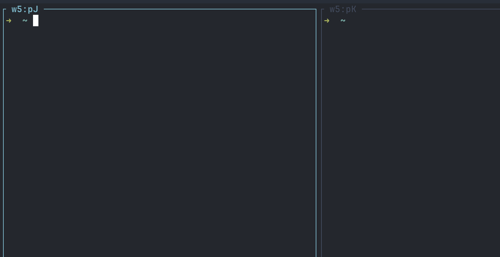

# herdr-pane-id-labels

A [Herdr](https://herdr.dev) plugin that labels every pane with its own pane ID
(e.g. `w5:p2`), so the ID is visible on the pane border without opening the sidebar.




## What it does

- **On Herdr startup:** labels every pane, including panes restored from the last session.
- **On `pane.created`:** labels new panes (splits, new tabs, new workspaces).
- **On `pane.moved`:** relabels with the new ID. A move to another workspace changes the
  pane ID (`w6:p1` → `w7:p2`), and the border follows.
- **Keeps your names:** only panes with no label or an ID-shaped label (`wX:pY`) are touched.
  Rename a pane yourself and the plugin leaves it alone.

## Install

```sh
herdr plugin install <owner>/herdr-pane-id-labels
herdr plugin action invoke pane-id-labels.relabel   # label already-open panes now
```

Requirements: Herdr 0.9.4+, macOS or Linux, `jq` on the `PATH` seen by the Herdr server.

### Recommended config

A plugin can't edit your config. Add these to `~/.config/herdr/config.toml` yourself:

```toml
[ui]
# Draw a border (and therefore the label) even on a lone pane.
pane_borders = "always"

# Optional: also show the label in the Agents sidebar.
[ui.sidebar.agents]
rows = [["state_icon", "machine", "workspace", "tab", "pane"], ["agent"]]
```

Then run `herdr server reload-config`.

## Notes

- The label is a manual pane name, so `show_agent_labels_on_pane_borders` has no effect on
  labeled panes.
- If a plugin or integration reports a pane title (`herdr pane report-metadata --title`),
  the title shows on the border instead of the label.
- Clear one pane's label: `herdr pane rename <id> --clear`.
- Uninstall: `herdr plugin uninstall pane-id-labels`. Existing labels stay until cleared.
- Native support is requested in [herdr#2204](https://github.com/herdrdev/herdr/discussions/2204).

## License

MIT
